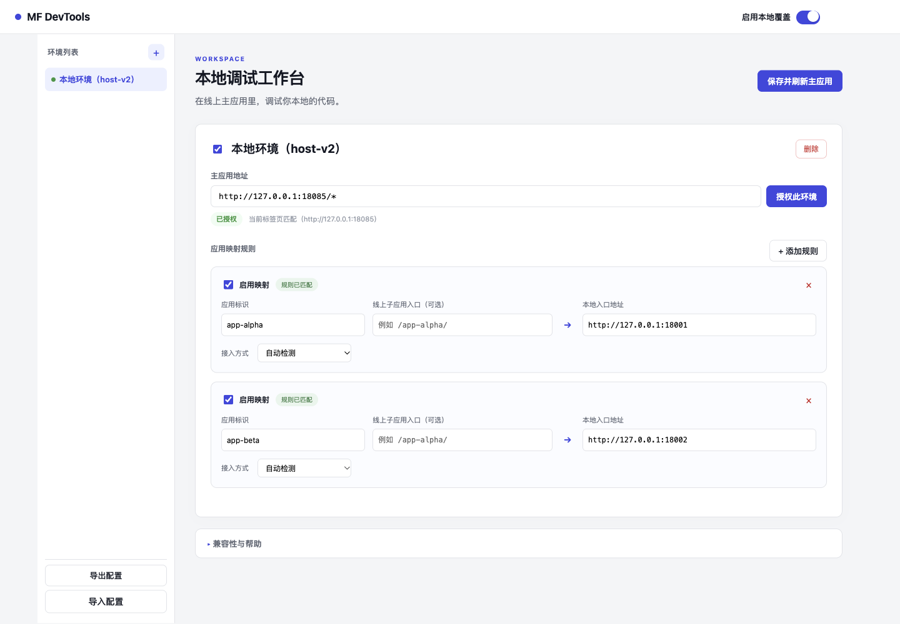

# MF DevTools · 微前端本地调试（0.3.0）

这是一个 Manifest V3 浏览器插件：在插件界面配置主应用环境、子应用标识和本地入口，访问原主应用时，将匹配的子应用入口切到本地。支持的主应用无需添加本插件的 resolver、脚本或握手接口。

## 开始使用

在 Ego Lite 加载 `extension/` 后，点击扩展图标 → **管理配置**。

1. 添加环境，填写环境名称和主应用地址，例如 `https://test.example.com`。粘贴完整网址也会自动提取域名。
2. 点击 **授权此环境**，在浏览器提示中允许这个站点。没有授权的环境不会注入脚本。
3. 添加应用映射：填写真实的 qiankun 应用标识、本地入口地址；线上子应用入口可选，用作额外的字面包含匹配条件，不是正则表达式。
4. 开启环境、规则和总开关，点击 **保存并刷新主应用**。
5. 修改本地代码后由对应 Vite 服务热更新。关闭某条映射并保存、刷新，可恢复该应用的线上版本；弹窗总开关会刷新当前主应用。

示例：

| 配置项 | 示例 |
|---|---|
| 主应用地址 | `https://test.example.com` |
| 应用标识 | `app-orders`（须与实际应用名一致） |
| 线上入口匹配 | `/app-orders/`（可选） |
| 本地入口 | `http://localhost:5173/app-orders/?layout=main` |
| 接入方式 | 自动检测 |

本地入口请填写完整的应用路径；插件不会把它截成根路径。线上入口中存在而本地入口未指定的查询参数会保留，本地填写的同名参数优先。配置自动保存；由于 qiankun 会缓存按名称和容器加载的应用，**修改配置后应刷新主应用**，界面会提示“刷新后生效”。

## 界面预览



## 安装与打包

- 源码安装：Ego Lite 扩展管理页 → 开发者模式 → 加载未打包的扩展程序 → 选择本项目 `extension` 文件夹。
- 发布包：`dist/mf-devtools-0.3.0.zip`。解压后选择直接包含 `manifest.json` 的目录加载。重新打包可运行 `python3 scripts/package-extension.py`。
- 配置可以在设置页导入/导出 JSON。导入不会自动授予新增站点权限，需分别点击授权。

## 兼容范围

两种明确的运行时接入方式：

- 主应用原本已公开 `window.APP.router`，提供可写的 Vue Router 风格 `addRoute/getRoutes` 接口；子应用配置位于路由 `props`、命名视图 props、props 工厂或 `meta` 中，形如 `{name, entry, ...}`。插件只改 `entry`，保留容器、baseRoute、别名、守卫及其他参数。本次真实浏览器验收使用 Vue 3 / Vue Router 4、私有打包的 qiankun 2.10.9。
- 主应用原本通过可写的 `window.qiankun.loadMicroApp` 加载子应用。插件保留同步返回 parcel 的调用方式及生命周期 Promise。

若两个入口均未公开，或公开对象只读，本版本会提示不支持，**不承诺能自动接管任意完全私有打包的项目**。不要求业务主应用专门暴露本插件 API。

本地 Vite 子应用仍须具备正常的 qiankun 生命周期适配（示例使用 vite-plugin-qiankun）。插件对匹配的入口 HTML 做有界加载协调，兼容该插件的生命周期注册约定；不改写原生 ESM 模块或 HMR 地址。示例验证了两个本地应用同页运行和互不影响的热更新。其他开发适配器、超过 8 秒仍未注册的初始化需要单独验证；超时会记录提示并释放队列。

本地服务需允许主应用访问（例如 Vite CORS）；页面 CSP、浏览器本地网络访问要求仍有效，插件不会关闭它们。服务探测失败时保留原线上入口，并显示“服务不可用”。

## 登录和接口

主页面停留在原环境，子应用相对路径 `/api/...` 仍请求主应用所在环境。插件不读取 Cookie、不申请 cookies 权限。真实请求中的 Cookie 由浏览器正常处理。

本次使用模拟的 HttpOnly、SameSite=Lax、Path=/ Cookie，验证了携带时返回 200、主动省略时返回 401、退出后失效，以及刷新/重新挂载后的认证。HTTP 回环演示没有 Secure 属性；真实 HTTPS、SSO 和跨站认证需在目标环境另行验证。

## 本地演示

默认的本地演示地址：

- 主应用：`http://127.0.0.1:18085/#/both`
- 公开 qiankun 接口的独立主应用：`http://127.0.0.1:18085/exposed.html`
- 本地 Alpha / Beta：`127.0.0.1:18001` / `127.0.0.1:18002`
- 模拟接口：`127.0.0.1:18090`
- 模拟账号：`demo-user` / `demo-pass`（仅本项目合成数据）

首次运行需安装 Node.js 和 Nginx（macOS 默认查找 Homebrew 的 Nginx，可通过 `NGINX_BIN` 指定其他路径），并分别在 `host`、`host-v2`、`app-alpha`、`app-beta` 目录执行 `npm ci`。

```bash
bash scripts/build-online.sh
bash scripts/start-all.sh
# 停止本项目自己启动并记录 PID 的服务
bash scripts/stop-all.sh
```

已有服务运行时不要重复启动。Nginx 使用项目自己的配置和 PID，不依赖系统级 Nginx 服务。主应用为 Nginx 提供的构建产物，线上备用子应用为普通 qiankun UMD 包；两个本地子应用分别运行 Vite 服务。

## 验收与材料

- 全部最终浏览器验收使用 **Ego Lite**，实际加载 `extension/`；没有用替代脚本模拟插件。
- `tests/ego-lite/acceptance.js`：核心可重复执行断言。运行前提及路径、扩展 ID 的配置见 `tests/ego-lite/README.md`。
- `evidence/v2/`：最终 JSON 结果、权限范围、两种适配器、主应用关闭插件对照及界面截图。
- `TEST_REPORT.md`：当前版本结果与边界。
- 旧版 Playwright 和早期开发记录保留于本地，未上传到本仓库，不作为 0.3.0 验收结论。
